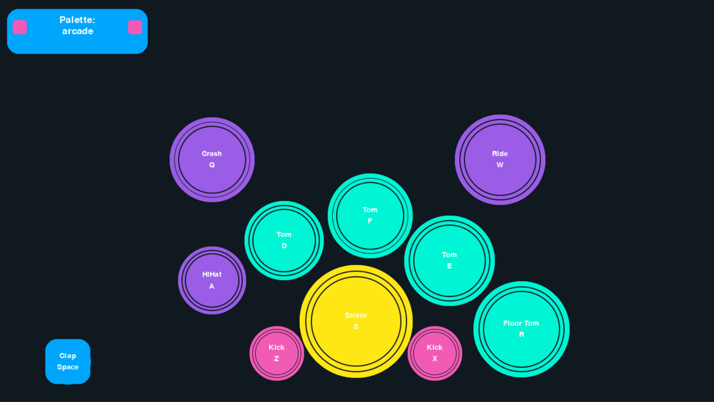
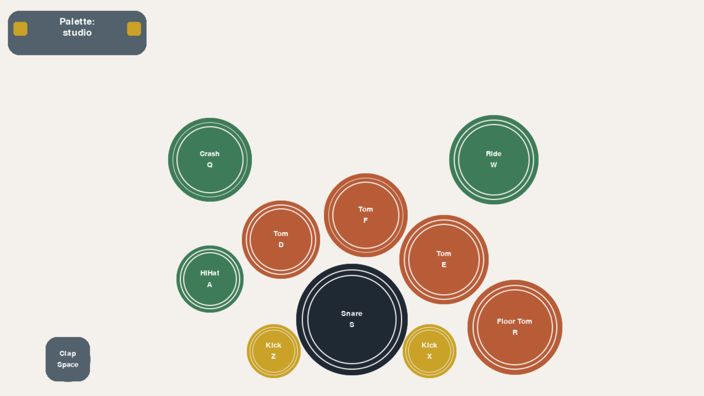
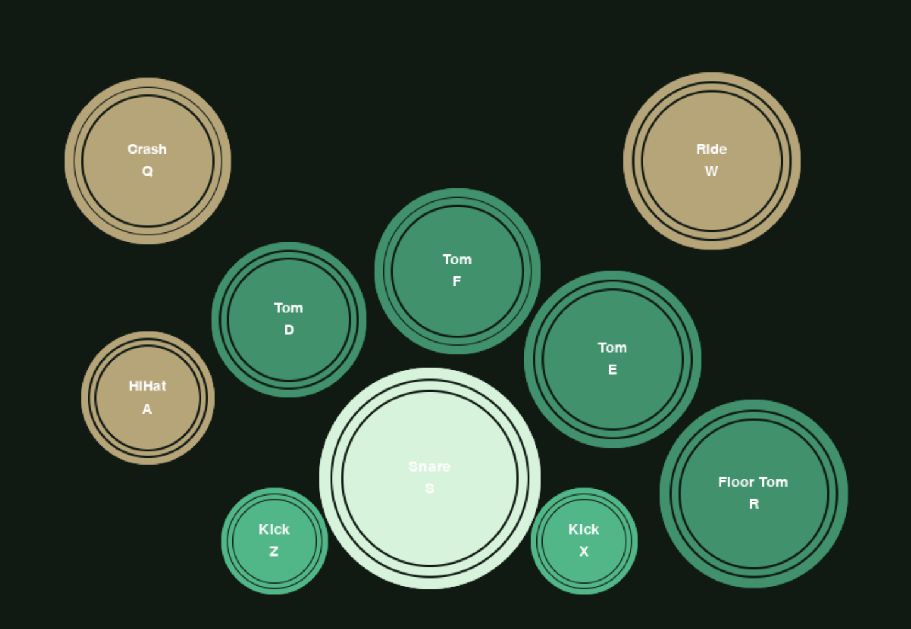

# Virtual Drum Kit

#### Video Demo:  https://youtu.be/h_Gbi1kDIK0

An interactive drum kit built with Python and Pygame. Players can perform using either the keyboard or the mouse, with visual feedback, multiple drum samples, and switchable colour themes.

The project was created as my CS50 Final Project and demonstrates object-oriented programming, event-driven design, audio playback, and graphical user interface development using Pygame.

---

## Features

- Play a full virtual drum kit
- Keyboard controls for all instruments
- Mouse support
- Multiple sound variations for selected drums
- Multiple colour palettes
- Visual feedback when instruments are played
- Dynamic volume variation for a more natural sound
- Object-oriented design using a custom `Instrument` class

---

## Instruments

The kit includes:

- Kick Drum
- Snare Drum
- Hi-Hat
- Clap
- Tom 1
- Tom 2
- Tom 3
- Floor Tom
- Crash Cymbal
- Ride Cymbal

---

## Controls

| Instrument | Keys | Numpad Keyboard |
|------------|----------|--------|
| Crash | Q | 7 |
| Hi-Hat | A | 4 |
| Snare | S | 2 |
| Tom 1 | D | 5 |
| Tom 2 | F | 6 |
| Tom 3 | E | + |
| Floor Tom | R | 8 |
| Ride | W | 9 |
| Kick (Left) | Z | 1 |
| Kick (Right) | X | 3 |
| Clap | C / Space | — |

All instruments can also be played using the mouse.

### Note
The application supports both standard keyboard controls and numeric keypad controls, allowing players to use whichever layout feels most comfortable or to use both hands. I always wondered why the numpad is rarely used in similar applications.

In the future, I might add a key-binding editor so users can customise the controls and create layouts that work best for them.

---

## Screenshots





Example:

```text
screenshots/drumkit.png
```

---

## Installation

### Clone the repository

```bash
git clone https://github.com/sierrawild/virtual_drum_kit.git
cd virtual_drum_kit
```

### Install dependencies

```bash
pip install -r requirements.txt
```

### Run the project

```bash
python main.py
```

---

## Project Structure

```text
virtual_drum_kit/
│
├── main.py
├── instrument.py
├── drum_sounds.py
├── palettes.py
├── requirements.txt
│
└── samples/
    ├── kick-acoustic01.wav
    ├── snare-acoustic01.wav
    └── ...
```

---

## Design Choices

### Instrument Class

The core of the project is the `Instrument` class.

Each drum or cymbal is represented by an object that is responsible for:

- Drawing itself
- Handling mouse interaction
- Handling keyboard input
- Playing sounds
- Displaying labels
- Providing visual feedback when activated

Using a class allowed the behaviour of all instruments to be defined in a single place rather than repeating logic for every drum component.

### Multiple Sound Samples

Several instruments use more than one audio sample.

When an instrument is played, a random sample is selected. This helps create a more natural sound and avoids the repetitive effect that occurs when the same audio file is played repeatedly.

### Colour Palettes

Colour themes are stored separately from the main game logic.

This approach makes it easy to add or remove palettes without modifying the application code and keeps visual configuration separate from gameplay functionality.

---

## Challenges

One of the main challenges was creating a system that worked consistently with both keyboard and mouse input while providing immediate visual and audio feedback.

Another challenge was balancing simplicity with realism. To improve the playing experience, random sound variations and slight volume differences were introduced to make repeated hits feel less mechanical.

---

## What I Learned

Through this project I gained experience with:

- Object-oriented programming
- Event-driven programming
- Pygame graphics and input handling
- Audio playback using Pygame Mixer
- Code organisation across multiple modules
- Managing project assets and configuration data
- Designing reusable classes

---

## Future Improvements

Potential future features include:

- Overlapping instruments
- Draggable and editable instrument placement
- Recording and playback
- Custom key bindings
- Additional drum kits and sound packs
- Volume controls
- Saveable user settings

---

## Author

**Paweł Babiak**

Created as the final project for **Harvard CS50 Introduction to Computer Science**.
